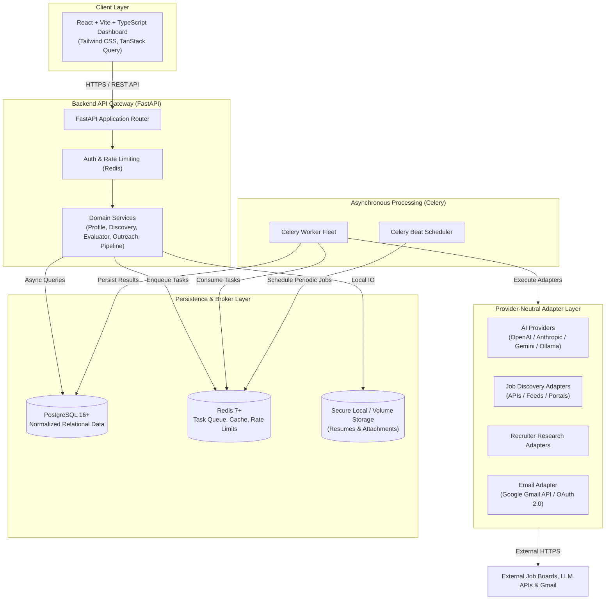

# AI Recruiter — System Architecture Assessment & Specification

**Document Version:** 1.0.0  
**Status:** Under Review  
**Date:** November 9, 2026  
**Repository:** `ai-recruiter`  

---

## 1. System Overview & Core Objectives

**AI Recruiter** is an intelligent, personal career discovery, recruiter identification, opportunity evaluation, and professional outreach management platform. It is engineered from the ground up as a candidate-centric platform designed to automate and optimize the modern software engineering job search workflow while maintaining strict human agency over external communications and professional representation.

### Primary Capabilities:
1. **Candidate Profile Management:** Configurable, structured storage of skills, experiences, target compensation, seniority preferences, and tailored resume artifacts without hardcoding candidate details into business logic.
2. **Modular Job Discovery:** Pluggable adapter architecture to aggregate job opportunities across authorized APIs, company career portals, and public aggregators, complete with deduplication and expiration tracking.
3. **AI Opportunity Evaluation:** Multi-factor analysis using LLMs (structured Pydantic schemas) comparing opportunities against verified candidate criteria, calculating suitability scores, gap analysis, and recommendations.
4. **Recruiter Identification & Contact Verification:** Discovering relevant technical recruiters, hiring managers, and talent partners associated with target roles, with strict evidence-based verification.
5. **Human-in-the-Loop Outreach & Gmail Integration:** Automated drafting of personalized outreach emails, coupled with an ironclad human approval gateway before any message is dispatched via authorized Google APIs.
6. **End-to-End Recruitment Pipeline:** A 18-stage state machine tracking opportunities from discovery to interview, offer, or archival.

---

## 2. Core Architectural Principles

- **Python-First Backend:** The backend is written exclusively in modern Python (3.12+) using FastAPI, Pydantic v2, and SQLAlchemy 2.0. No Node.js or Next.js backend services exist.
- **Independent RESTful API:** The backend is a completely decoupled service offering a documented OpenAPI (Swagger) contract. It can be fully operated via CLI, programmatic scripts, or headless workers without the web frontend.
- **Provider-Neutral Adapter Abstractions:** External systems (AI LLM providers, job search sources, contact research services, email providers) are mediated through strict abstract base classes (ABCs). Switching or mixing providers requires zero core business logic changes.
- **Human-in-the-Loop (HITL) Gateways:** AI generates recommendations and email drafts; under no circumstances can an autonomous background task send an email or make an external commitment without affirmative, recorded human approval.
- **Security by Design & Untrusted External Inputs:** All external job descriptions, scraped text, recruiter emails, and web pages are treated as untrusted data subject to prompt injection defenses and strict sanitization.
- **Pragmatic Modular Architecture:** Structured as a clean modular monolith backed by asynchronous task workers (Celery + Redis). This avoids unnecessary microservice complexity while delivering robust background execution.

---

## 3. High-Level Architecture Diagram



---

## 4. Subsystem Specifications

### 4.1 Backend Service (`backend/app`)
- **Framework:** FastAPI with asynchronous ASGI execution (Uvicorn).
- **Validation & Serialization:** Pydantic v2 schemas for request validation, configuration management (`pydantic-settings`), and strict output serialization.
- **Persistence & ORM:** SQLAlchemy 2.0 with asynchronous engine (`asyncpg` driver for PostgreSQL), Alembic for database migrations.
- **Security & Cryptography:** Passlib / Argon2 for user authentication, `cryptography` (Fernet / AES-256-GCM) for encrypting stored OAuth refresh tokens and API credentials at rest.
- **Dependency Injection:** Native FastAPI dependency injection for database sessions, authentication contexts, and service repositories.

### 4.2 Frontend Application (`frontend/`)
- **Tooling:** Vite + React 19 / 18 + TypeScript.
- **Design & UI:** Tailwind CSS with headless component primitives (Radix UI / Lucide React) for accessible, responsive design.
- **Server State Management:** TanStack React Query for caching, optimistic updates, and API polling.
- **Client Routing:** React Router v6+.
- **Build Output:** Static assets served via Nginx in containerized production, or Vite dev server with proxy during development.

### 4.3 Task Queue & Background Processing (`backend/app/tasks`)
- **Task Broker & Result Backend:** Redis 7.2.
- **Execution Framework:** Celery 5.4+.
- **Scheduler:** Celery Beat for periodic executions (e.g., daily job scraping, follow-up checks, recruiter response syncing).
- **Task Resilience:** Exponential backoff retries, dead-letter tracking, idempotency tokens to prevent duplicate task execution.

### 4.4 AI Orchestration & Model Routing (`backend/app/adapters/ai/`)
- **Abstract Interface:** `BaseAIProvider` defining asynchronous methods for structured completions, embeddings, and chat.
- **Provider Implementations:**
  - `OpenAIProvider` (GPT-4o, GPT-4o-mini)
  - `AnthropicProvider` (Claude 3.5 Sonnet, Claude 3.5 Haiku)
  - `GeminiProvider` (Gemini 1.5 Pro, Gemini 1.5 Flash)
  - `OllamaProvider` / Local Open-Weights (Llama 3, Mistral for zero-cost local inference)
- **Model Routing Strategy:**
  - *Tier 1 (High Reasoning):* Deep candidate-job match evaluation, complex company analysis, personalized cold outreach generation.
  - *Tier 2 (Fast / Low Cost):* Job description parsing, keyword extraction, raw text normalization, response sentiment classification.
- **Governance:** Strict JSON schema enforcement via Pydantic; real-time token and USD cost tracking recorded per evaluation in the database.

### 4.5 Job Discovery Engine (`backend/app/adapters/jobs/`)
- **Abstract Interface:** `BaseJobSourceAdapter` with methods:
  - `search_opportunities(query: JobSearchQuery) -> List[RawJobListing]`
  - `fetch_listing_details(external_id: str) -> RawJobListing`
- **Normalization Pipeline:** Ingests heterogeneous listing data into normalized `JobOpportunityCreate` schemas.
- **Deduplication Engine:** Multi-factor hashing based on normalized company name, normalized title, location, and canonicalized description text. Detects reposted roles across platforms.
- **Staleness Checker:** Periodic HEAD/GET requests and feed inspections to flag closed, expired, or 404 listings.

### 4.6 Recruiter Discovery & Contact Verification (`backend/app/adapters/recruiters/`)
- **Identification:** Discovers recruiters, engineering leaders, and talent partners linked to company domains and role postings.
- **Evidence-Based Contact Verification:**
  - Email syntax and domain MX-record validation.
  - Verification confidence score (0.0 to 1.0) based on source verification (e.g. public press release vs. pattern-matched corporate domain).
  - Explicit rule: **No email address is marked as verified or communicated with without cryptographically sound or evidence-backed validation.**

### 4.7 Professional Outreach Engine & Gmail Integration (`backend/app/adapters/email/`)
- **Draft Generation:** Tailors outreach to the specific opportunity and recruiter, referencing only verified candidate history and matching skills.
- **Human Approval State Machine:**
  ```mermaid
  stateDiagram-v2
      [*] --> Drafted: AI generates outreach
      Drafted --> AwaitingApproval: Candidate reviews draft
      AwaitingApproval --> Approved: User clicks "Approve & Send"
      AwaitingApproval --> Rejected: User discards or requests re-draft
      AwaitingApproval --> Edited: User modifies text / resume
      Edited --> Approved: User confirms edits
      Approved --> Sending: Worker dispatches to Gmail API
      Sending --> Sent: Gmail confirmation received
      Sending --> Failed: API error (Retryable)
      Sent --> Replied: Inbound message detected
      Sent --> NoResponse: Follow-up timer expires
  ```
- **Gmail API Integration:**
  - Google OAuth 2.0 with offline access (`access_type=offline`, `prompt=consent`).
  - Scopes limited to `gmail.compose`, `gmail.send`, `gmail.readonly`.
  - Automatic draft creation inside Gmail so candidate can also inspect drafts directly in Gmail web interface.
  - Inbound email tracking via thread IDs to classify recruiter responses.

---

## 5. Directory Structure & Module Boundaries

```
ai-recruiter/
├── docs/                                  # Architectural & development documentation
│   ├── AI_RECRUITER_ARCHITECTURE.md
│   ├── AI_RECRUITER_DEVELOPMENT_ROADMAP.md
│   ├── AI_RECRUITER_DATABASE_DESIGN.md
│   ├── AI_RECRUITER_SECURITY_REQUIREMENTS.md
│   └── AI_RECRUITER_CURRENT_STATE_AUDIT.md
├── docker/                                # Containerization manifests
│   ├── Dockerfile.backend
│   ├── Dockerfile.frontend
│   ├── Dockerfile.worker
│   └── docker-compose.yml
├── backend/                               # Python backend application
│   ├── pyproject.toml                     # Dependencies & package metadata
│   ├── alembic.ini                        # Alembic database migration config
│   ├── alembic/                           # Migration scripts
│   │   ├── env.py
│   │   └── versions/
│   ├── app/
│   │   ├── main.py                        # FastAPI entrypoint
│   │   ├── config.py                      # Pydantic Settings configuration
│   │   ├── core/                          # Cross-cutting concerns
│   │   │   ├── database.py                # SQLAlchemy session & engine
│   │   │   ├── security.py                # Password hashing, JWT, AES token encryption
│   │   │   └── logging.py                 # Structured JSON logging
│   │   ├── models/                        # SQLAlchemy ORM database models
│   │   │   ├── __init__.py
│   │   │   ├── candidate.py
│   │   │   ├── job.py
│   │   │   ├── company.py
│   │   │   ├── recruiter.py
│   │   │   ├── evaluation.py
│   │   │   ├── outreach.py
│   │   │   └── audit.py
│   │   ├── schemas/                       # Pydantic v2 request/response schemas
│   │   │   ├── candidate.py
│   │   │   ├── job.py
│   │   │   ├── evaluation.py
│   │   │   └── outreach.py
│   │   ├── api/                           # REST API endpoints grouped by domain
│   │   │   ├── v1/
│   │   │   │   ├── router.py
│   │   │   │   ├── auth.py
│   │   │   │   ├── candidate.py
│   │   │   │   ├── jobs.py
│   │   │   │   ├── recruiters.py
│   │   │   │   ├── evaluations.py
│   │   │   │   ├── outreach.py
│   │   │   │   └── pipeline.py
│   │   ├── services/                      # Domain business logic
│   │   │   ├── candidate_service.py
│   │   │   ├── discovery_service.py
│   │   │   ├── evaluation_service.py
│   │   │   ├── recruiter_service.py
│   │   │   └── outreach_service.py
│   │   ├── adapters/                      # External provider integrations (ABCs & Impls)
│   │   │   ├── ai/
│   │   │   │   ├── base.py
│   │   │   │   ├── router.py
│   │   │   │   ├── openai_adapter.py
│   │   │   │   ├── anthropic_adapter.py
│   │   │   │   ├── gemini_adapter.py
│   │   │   │   └── ollama_adapter.py
│   │   │   ├── jobs/
│   │   │   │   ├── base.py
│   │   │   │   └── feeds_adapter.py
│   │   │   ├── recruiters/
│   │   │   │   ├── base.py
│   │   │   │   └── research_adapter.py
│   │   │   └── email/
│   │   │       ├── base.py
│   │   │       └── gmail_adapter.py
│   │   └── tasks/                         # Celery tasks & Beat scheduler schedules
│   │       ├── celery_app.py
│   │       ├── discovery_tasks.py
│   │       ├── evaluation_tasks.py
│   │       └── sync_tasks.py
│   └── tests/                             # Pytest test suite
│       ├── conftest.py
│       ├── unit/
│       ├── integration/
│       └── security/
├── frontend/                              # React + Vite + TypeScript frontend
│   ├── package.json
│   ├── tsconfig.json
│   ├── vite.config.ts
│   ├── tailwind.config.js
│   ├── src/
│   │   ├── main.tsx
│   │   ├── App.tsx
│   │   ├── api/                           # Typed API clients
│   │   ├── components/                    # Reusable UI widgets
│   │   ├── pages/                         # Dashboard & pipeline views
│   │   │   ├── Overview.tsx
│   │   │   ├── Pipeline.tsx
│   │   │   ├── Jobs.tsx
│   │   │   ├── Recruiters.tsx
│   │   │   ├── OutreachApproval.tsx
│   │   │   └── Profile.tsx
│   │   └── hooks/
│   └── tests/                             # Vitest component tests
└── .gitignore
```

---

## 6. Dependency Compatibility Matrix

| Category | Package | Target Version | Compatibility Rationale |
|---|---|---|---|
| **API Framework** | `fastapi` | `^0.115.0` | Latest stable, native Pydantic v2 support, high throughput ASGI |
| **Validation** | `pydantic` | `^2.9.0` | High performance Rust-based serialization, native JSON Schema generation |
| **Settings** | `pydantic-settings` | `^2.5.0` | Decoupled environment configuration |
| **ASGI Server** | `uvicorn[standard]` | `^0.31.0` | Stable production ASGI server with HTTP/1.1 and WebSocket support |
| **ORM** | `sqlalchemy` | `^2.0.35` | Modern async Core & ORM with 2.0 type-hinting support |
| **PostgreSQL Driver**| `asyncpg` | `^0.29.0` | High-performance asynchronous PostgreSQL client library |
| **Migrations** | `alembic` | `^1.13.0` | Standard industry database schema migration tool |
| **Background Queue** | `celery` | `^5.4.0` | Proven enterprise task queue with robust retry semantics |
| **Cache & Broker** | `redis` | `^5.1.0` | Redis Python client with async connection pool support |
| **Security** | `cryptography` | `^43.0.0` | Standard cryptographic recipes for AES-256-GCM token encryption |
| **Password Hashing** | `passlib[argon2]` | `^1.7.4` | Modern password hashing recommended by OWASP |
| **JWT** | `python-jose[cryptography]`| `^3.3.0` | Safe JWT encoding and decoding |
| **HTTP Client** | `httpx` | `^0.27.2` | Async HTTP client for external AI and job API integrations |
| **Google APIs** | `google-api-python-client`, `google-auth-oauthlib` | Current Stable | Official authorized Google SDKs for Gmail OAuth2 |
| **Testing** | `pytest`, `pytest-asyncio`, `pytest-cov` | Current Stable | Async test harness with fixture isolation |
| **Frontend Core** | `react`, `react-dom` | `^18.3.1` or `^19.0.0` | Production standard React ecosystem |
| **Frontend Tooling** | `vite` | `^5.4.0` or `^6.0.0` | Extremely fast modern frontend bundler |
| **Frontend Styling**| `tailwindcss`, `postcss`, `autoprefixer` | `^3.4.0` | Utility-first responsive CSS styling |
| **Data Fetching** | `@tanstack/react-query` | `^5.56.0` | Server state synchronization, caching, and retry logic |

---

## 7. Architectural Decisions (ADR Summary)

1. **ADR-001: Python Modular Monolith over Microservices**  
   *Decision:* Keep backend domain logic in a single cohesive codebase with clear module boundaries rather than separating into independent microservices.  
   *Rationale:* Minimizes operational overhead, avoids network serialization latency, simplifies transaction management, and allows rapid iteration for a single-candidate recruiting system while retaining horizontal scalability via Celery workers.

2. **ADR-002: Asyncpg and SQLAlchemy 2.0 for Data Access**  
   *Decision:* Standardize exclusively on async SQLAlchemy 2.0 with the `asyncpg` driver.  
   *Rationale:* High concurrency for I/O-bound scraping and external AI calls without blocking FastAPI event loops.

3. **ADR-003: Mandatory Approval State Gate for Email Outreach**  
   *Decision:* The database schema strictly prohibits any outreach record with status `SENT` unless it transitions through `APPROVED` with an associated `approved_at` timestamp and user ID.  
   *Rationale:* Protects candidate reputation and ensures zero hallucinated communications are ever transmitted.

4. **ADR-004: Decoupled AI Layer via Provider Adapters**  
   *Decision:* Business services communicate with an abstract `BaseAIProvider` class rather than directly importing vendor SDKs.  
   *Rationale:* Guarantees that switching between OpenAI, Anthropic, Gemini, or local models requires zero modifications to evaluation, parsing, or outreach logic.
