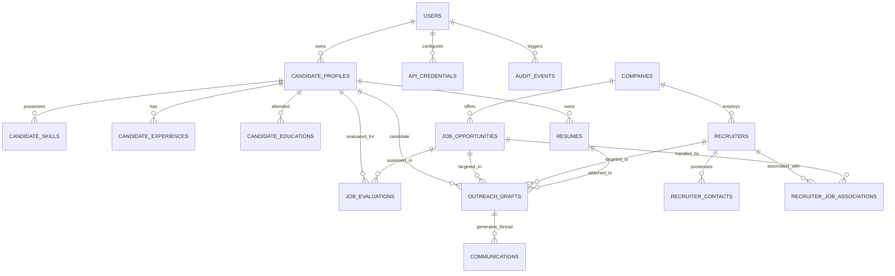

# AI Recruiter — Database Architecture & Schema Specification

**Document Version:** 1.0.0  
**Database Engine:** PostgreSQL 16+  
**ORM:** SQLAlchemy 2.0 (Async)  
**Migration Framework:** Alembic  
**Target Schema Version:** `0001_initial_core`  

---

## 1. Design Principles & Schema Standards

1. **Normalization & Integrity:** Designed to Third Normal Form (3NF) to guarantee transactional consistency, eliminate data redundancy, and maintain strict referential integrity.
2. **Predictable Identifiers & Types:**
   - Primary Keys: UUIDv4 (`UUID(as_uuid=True)`) or high-capacity `BigInteger` with sequence generation. Standardizing on `UUID` for distributed security, API enumeration prevention, and cross-system sync.
   - Timestamps: All timestamps are timezone-aware UTC (`TIMESTAMP WITH TIME ZONE`).
   - Naming Conventions: Strict `snake_case` for tables, columns, indexes, foreign keys, and constraints.
3. **Auditability & Soft Archival:**
   - Core entities contain `created_at` and `updated_at` automatically maintained by database triggers or ORM events.
   - Deletions are guarded with soft-delete or explicit lifecycle stages (e.g. `ARCHIVED`, `REJECTED`).
4. **Encryption at Rest for Sensitive Fields:**
   - OAuth tokens, refresh tokens, and private API keys are encrypted before persistence using AES-256-GCM.
5. **Deduplication Engine:**
   - Job listings use an indexed cryptographic SHA-256 deduplication hash generated from normalized company domain, normalized job title, and sanitized description text.

---

## 2. Entity-Relationship Overview



---

## 3. Detailed Table Specifications

### 3.1 Authentication & Candidate Profile Subsystem

#### Table: `users`
Represents system operators / candidates using the personal platform.
```sql
CREATE TABLE users (
    id UUID PRIMARY KEY DEFAULT gen_random_uuid(),
    email VARCHAR(255) NOT NULL UNIQUE,
    hashed_password VARCHAR(255) NOT NULL,
    full_name VARCHAR(120) NOT NULL,
    is_active BOOLEAN NOT NULL DEFAULT TRUE,
    is_superuser BOOLEAN NOT NULL DEFAULT FALSE,
    created_at TIMESTAMPTZ NOT NULL DEFAULT CURRENT_TIMESTAMP,
    updated_at TIMESTAMPTZ NOT NULL DEFAULT CURRENT_TIMESTAMP
);
CREATE INDEX ix_users_email ON users(email);
```

#### Table: `candidate_profiles`
Configurable candidate persona, professional preferences, and search parameters.
```sql
CREATE TABLE candidate_profiles (
    id UUID PRIMARY KEY DEFAULT gen_random_uuid(),
    user_id UUID NOT NULL REFERENCES users(id) ON DELETE CASCADE,
    headline VARCHAR(255) NOT NULL,
    summary TEXT NOT NULL,
    target_seniority VARCHAR(50) NOT NULL, -- 'Senior', 'Staff', 'Lead', 'Principal'
    location_base VARCHAR(100) NOT NULL,  -- 'United States'
    remote_preference VARCHAR(30) NOT NULL DEFAULT 'REMOTE_FIRST', -- 'REMOTE_ONLY', 'REMOTE_FIRST', 'HYBRID'
    employment_types VARCHAR(50)[] NOT NULL, -- ARRAY['FULL_TIME', 'CONTRACT']
    target_min_salary INTEGER NULL,
    preferred_currency VARCHAR(3) NOT NULL DEFAULT 'USD',
    work_authorization_status VARCHAR(50) NOT NULL DEFAULT 'US_CITIZEN',
    is_active BOOLEAN NOT NULL DEFAULT TRUE,
    created_at TIMESTAMPTZ NOT NULL DEFAULT CURRENT_TIMESTAMP,
    updated_at TIMESTAMPTZ NOT NULL DEFAULT CURRENT_TIMESTAMP
);
CREATE INDEX ix_candidate_profiles_user_id ON candidate_profiles(user_id);
```

#### Table: `candidate_skills`
Verified candidate technical capabilities and experience tenure.
```sql
CREATE TABLE candidate_skills (
    id UUID PRIMARY KEY DEFAULT gen_random_uuid(),
    candidate_id UUID NOT NULL REFERENCES candidate_profiles(id) ON DELETE CASCADE,
    name VARCHAR(100) NOT NULL,
    category VARCHAR(50) NOT NULL, -- 'Backend', 'Frontend', 'AI_ML', 'Security', 'Cloud'
    years_experience NUMERIC(4, 1) NOT NULL,
    proficiency_level VARCHAR(30) NOT NULL DEFAULT 'EXPERT', -- 'INTERMEDIATE', 'ADVANCED', 'EXPERT'
    is_primary BOOLEAN NOT NULL DEFAULT FALSE,
    created_at TIMESTAMPTZ NOT NULL DEFAULT CURRENT_TIMESTAMP,
    CONSTRAINT uq_candidate_skill UNIQUE (candidate_id, name)
);
CREATE INDEX ix_candidate_skills_name ON candidate_skills(name);
```

#### Table: `candidate_experiences`
Detailed, verified employment history and technical achievements.
```sql
CREATE TABLE candidate_experiences (
    id UUID PRIMARY KEY DEFAULT gen_random_uuid(),
    candidate_id UUID NOT NULL REFERENCES candidate_profiles(id) ON DELETE CASCADE,
    company_name VARCHAR(150) NOT NULL,
    title VARCHAR(150) NOT NULL,
    location VARCHAR(100) NULL,
    is_current BOOLEAN NOT NULL DEFAULT FALSE,
    start_date DATE NOT NULL,
    end_date DATE NULL,
    summary TEXT NOT NULL,
    technologies_used VARCHAR(100)[] NOT NULL DEFAULT '{}',
    accomplishments JSONB NOT NULL DEFAULT '[]',
    created_at TIMESTAMPTZ NOT NULL DEFAULT CURRENT_TIMESTAMP
);
CREATE INDEX ix_candidate_exp_candidate_id ON candidate_experiences(candidate_id);
```

#### Table: `resumes`
Candidate resume versions and tailored artifacts.
```sql
CREATE TABLE resumes (
    id UUID PRIMARY KEY DEFAULT gen_random_uuid(),
    candidate_id UUID NOT NULL REFERENCES candidate_profiles(id) ON DELETE CASCADE,
    label VARCHAR(100) NOT NULL, -- 'Standard Backend/AI', 'Senior Fullstack'
    file_path VARCHAR(512) NOT NULL,
    file_hash VARCHAR(64) NOT NULL, -- SHA-256
    file_size_bytes INTEGER NOT NULL,
    mime_type VARCHAR(50) NOT NULL DEFAULT 'application/pdf',
    parsed_markdown TEXT NULL,
    target_role_category VARCHAR(100) NULL,
    is_primary BOOLEAN NOT NULL DEFAULT FALSE,
    created_at TIMESTAMPTZ NOT NULL DEFAULT CURRENT_TIMESTAMP,
    updated_at TIMESTAMPTZ NOT NULL DEFAULT CURRENT_TIMESTAMP
);
CREATE INDEX ix_resumes_candidate_id ON resumes(candidate_id);
```

---

### 3.2 Companies, Jobs & Recruitment Pipeline Subsystem

#### Table: `companies`
Target hiring organizations.
```sql
CREATE TABLE companies (
    id UUID PRIMARY KEY DEFAULT gen_random_uuid(),
    name VARCHAR(200) NOT NULL,
    normalized_name VARCHAR(200) NOT NULL,
    domain VARCHAR(255) NULL UNIQUE,
    industry VARCHAR(100) NULL,
    company_size VARCHAR(50) NULL,
    website_url VARCHAR(500) NULL,
    careers_url VARCHAR(500) NULL,
    linkedin_url VARCHAR(500) NULL,
    description TEXT NULL,
    created_at TIMESTAMPTZ NOT NULL DEFAULT CURRENT_TIMESTAMP,
    updated_at TIMESTAMPTZ NOT NULL DEFAULT CURRENT_TIMESTAMP
);
CREATE INDEX ix_companies_normalized_name ON companies(normalized_name);
```

#### Table: `job_opportunities`
Aggregated employment opportunities across all discovery adapters.
```sql
CREATE TABLE job_opportunities (
    id UUID PRIMARY KEY DEFAULT gen_random_uuid(),
    company_id UUID NOT NULL REFERENCES companies(id) ON DELETE RESTRICT,
    title VARCHAR(250) NOT NULL,
    normalized_title VARCHAR(250) NOT NULL,
    location VARCHAR(150) NOT NULL,
    remote_type VARCHAR(30) NOT NULL, -- 'REMOTE', 'HYBRID', 'ONSITE'
    employment_type VARCHAR(30) NOT NULL, -- 'FULL_TIME', 'CONTRACT', 'PART_TIME'
    min_salary NUMERIC(12, 2) NULL,
    max_salary NUMERIC(12, 2) NULL,
    currency VARCHAR(3) NOT NULL DEFAULT 'USD',
    source_adapter VARCHAR(50) NOT NULL, -- 'greenhouse', 'lever', 'feed', 'manual'
    external_job_id VARCHAR(255) NULL,
    source_url VARCHAR(1000) NOT NULL,
    raw_description TEXT NOT NULL,
    cleaned_description TEXT NOT NULL,
    dedup_hash VARCHAR(64) NOT NULL UNIQUE, -- SHA-256(company_domain + title + normalized_body)
    pipeline_stage VARCHAR(50) NOT NULL DEFAULT 'DISCOVERED',
    -- 18 Stages: DISCOVERED, EVALUATED, QUALIFIED, RECRUITER_IDENTIFIED, CONTACT_VERIFIED,
    -- OUTREACH_DRAFTED, AWAITING_APPROVAL, SENT, REPLIED, INTERESTED, SCREENING,
    -- INTERVIEW, TECHNICAL_ASSESSMENT, OFFER, HIRED, REJECTED, NO_RESPONSE, ARCHIVED
    published_at TIMESTAMPTZ NULL,
    discovered_at TIMESTAMPTZ NOT NULL DEFAULT CURRENT_TIMESTAMP,
    expired_at TIMESTAMPTZ NULL,
    is_active BOOLEAN NOT NULL DEFAULT TRUE,
    created_at TIMESTAMPTZ NOT NULL DEFAULT CURRENT_TIMESTAMP,
    updated_at TIMESTAMPTZ NOT NULL DEFAULT CURRENT_TIMESTAMP
);
CREATE INDEX ix_jobs_pipeline_stage ON job_opportunities(pipeline_stage);
CREATE INDEX ix_jobs_dedup_hash ON job_opportunities(dedup_hash);
CREATE INDEX ix_jobs_remote_type ON job_opportunities(remote_type);
CREATE INDEX ix_jobs_company_id ON job_opportunities(company_id);
```

---

### 3.3 Recruiter Discovery & Verification Subsystem

#### Table: `recruiters`
Identified talent acquisition professionals and engineering managers.
```sql
CREATE TABLE recruiters (
    id UUID PRIMARY KEY DEFAULT gen_random_uuid(),
    company_id UUID NULL REFERENCES companies(id) ON DELETE SET NULL,
    full_name VARCHAR(150) NOT NULL,
    title VARCHAR(150) NOT NULL,
    recruiter_type VARCHAR(50) NOT NULL DEFAULT 'INTERNAL_TA', -- 'INTERNAL_TA', 'HIRING_MANAGER', 'AGENCY_RECRUITER'
    linkedin_url VARCHAR(500) NULL,
    public_profile_url VARCHAR(500) NULL,
    source_of_discovery VARCHAR(100) NOT NULL,
    notes TEXT NULL,
    created_at TIMESTAMPTZ NOT NULL DEFAULT CURRENT_TIMESTAMP,
    updated_at TIMESTAMPTZ NOT NULL DEFAULT CURRENT_TIMESTAMP
);
CREATE INDEX ix_recruiters_company_id ON recruiters(company_id);
```

#### Table: `recruiter_contacts`
Verified contact information with confidence scoring and audit trails.
```sql
CREATE TABLE recruiter_contacts (
    id UUID PRIMARY KEY DEFAULT gen_random_uuid(),
    recruiter_id UUID NOT NULL REFERENCES recruiters(id) ON DELETE CASCADE,
    contact_type VARCHAR(20) NOT NULL, -- 'EMAIL', 'LINKEDIN_MESSAGE', 'PHONE'
    contact_value VARCHAR(255) NOT NULL,
    is_verified BOOLEAN NOT NULL DEFAULT FALSE,
    verification_method VARCHAR(100) NULL, -- 'MX_CHECK', 'AUTHORITATIVE_SOURCE', 'DIRECT_INBOUND'
    confidence_score NUMERIC(3, 2) NOT NULL DEFAULT 0.00, -- 0.00 to 1.00
    verification_evidence JSONB NOT NULL DEFAULT '{}',
    verified_at TIMESTAMPTZ NULL,
    created_at TIMESTAMPTZ NOT NULL DEFAULT CURRENT_TIMESTAMP,
    CONSTRAINT uq_recruiter_contact UNIQUE (recruiter_id, contact_type, contact_value)
);
CREATE INDEX ix_recruiter_contacts_val ON recruiter_contacts(contact_value);
```

#### Table: `recruiter_job_associations`
Maps recruiters to specific job opportunities.
```sql
CREATE TABLE recruiter_job_associations (
    id UUID PRIMARY KEY DEFAULT gen_random_uuid(),
    recruiter_id UUID NOT NULL REFERENCES recruiters(id) ON DELETE CASCADE,
    job_id UUID NOT NULL REFERENCES job_opportunities(id) ON DELETE CASCADE,
    association_type VARCHAR(50) NOT NULL DEFAULT 'PRIMARY_RECRUITER', -- 'PRIMARY_RECRUITER', 'HIRING_MANAGER', 'SOURCER'
    created_at TIMESTAMPTZ NOT NULL DEFAULT CURRENT_TIMESTAMP,
    CONSTRAINT uq_recruiter_job UNIQUE (recruiter_id, job_id)
);
```

---

### 3.4 AI Evaluation Subsystem

#### Table: `job_evaluations`
Structured multi-factor analysis comparing candidate criteria against job requirements.
```sql
CREATE TABLE job_evaluations (
    id UUID PRIMARY KEY DEFAULT gen_random_uuid(),
    job_id UUID NOT NULL REFERENCES job_opportunities(id) ON DELETE CASCADE,
    candidate_id UUID NOT NULL REFERENCES candidate_profiles(id) ON DELETE CASCADE,
    overall_score NUMERIC(4, 1) NOT NULL, -- 0.0 to 100.0
    technical_match_score NUMERIC(4, 1) NOT NULL,
    seniority_fit_score NUMERIC(4, 1) NOT NULL,
    compensation_fit_score NUMERIC(4, 1) NULL,
    recommendation VARCHAR(30) NOT NULL, -- 'STRONG_APPLY', 'APPLY', 'CONSIDER', 'SKIP'
    mandatory_skills_met JSONB NOT NULL DEFAULT '[]',
    preferred_skills_met JSONB NOT NULL DEFAULT '[]',
    missing_qualifications JSONB NOT NULL DEFAULT '[]',
    strengths JSONB NOT NULL DEFAULT '[]',
    potential_concerns JSONB NOT NULL DEFAULT '[]',
    rationale_markdown TEXT NOT NULL,
    ai_provider VARCHAR(50) NOT NULL, -- 'openai', 'anthropic', 'gemini', 'ollama'
    ai_model VARCHAR(100) NOT NULL,
    prompt_version VARCHAR(20) NOT NULL,
    prompt_tokens INTEGER NOT NULL,
    completion_tokens INTEGER NOT NULL,
    cost_usd NUMERIC(8, 5) NOT NULL DEFAULT 0.00000,
    created_at TIMESTAMPTZ NOT NULL DEFAULT CURRENT_TIMESTAMP
);
CREATE INDEX ix_evaluations_job_candidate ON job_evaluations(job_id, candidate_id);
CREATE INDEX ix_evaluations_overall_score ON job_evaluations(overall_score DESC);
```

---

### 3.5 Outreach, Communications & Approval Subsystem

#### Table: `outreach_drafts`
Generated professional communications awaiting or possessing explicit human sign-off.
```sql
CREATE TABLE outreach_drafts (
    id UUID PRIMARY KEY DEFAULT gen_random_uuid(),
    job_id UUID NOT NULL REFERENCES job_opportunities(id) ON DELETE CASCADE,
    recruiter_id UUID NOT NULL REFERENCES recruiters(id) ON DELETE RESTRICT,
    candidate_id UUID NOT NULL REFERENCES candidate_profiles(id) ON DELETE RESTRICT,
    resume_id UUID NULL REFERENCES resumes(id) ON DELETE SET NULL,
    channel VARCHAR(30) NOT NULL DEFAULT 'GMAIL',
    subject VARCHAR(255) NOT NULL,
    body_markdown TEXT NOT NULL,
    body_html TEXT NOT NULL,
    status VARCHAR(30) NOT NULL DEFAULT 'AWAITING_APPROVAL',
    -- 'DRAFT', 'AWAITING_APPROVAL', 'APPROVED', 'REJECTED', 'SENT', 'FAILED', 'CANCELLED'
    approval_notes TEXT NULL,
    approved_at TIMESTAMPTZ NULL,
    approved_by_user_id UUID NULL REFERENCES users(id) ON DELETE SET NULL,
    sent_at TIMESTAMPTZ NULL,
    external_message_id VARCHAR(255) NULL, -- Gmail Message ID
    external_thread_id VARCHAR(255) NULL,  -- Gmail Thread ID
    created_at TIMESTAMPTZ NOT NULL DEFAULT CURRENT_TIMESTAMP,
    updated_at TIMESTAMPTZ NOT NULL DEFAULT CURRENT_TIMESTAMP,
    CONSTRAINT chk_outreach_sent_requires_approval CHECK (
        (status != 'SENT') OR (status = 'SENT' AND approved_at IS NOT NULL AND approved_by_user_id IS NOT NULL)
    )
);
CREATE INDEX ix_outreach_status ON outreach_drafts(status);
```

#### Table: `communications`
Inbound and outbound message logs maintaining conversational context and sentiment.
```sql
CREATE TABLE communications (
    id UUID PRIMARY KEY DEFAULT gen_random_uuid(),
    outreach_id UUID NULL REFERENCES outreach_drafts(id) ON DELETE SET NULL,
    external_thread_id VARCHAR(255) NOT NULL,
    external_message_id VARCHAR(255) NOT NULL UNIQUE,
    direction VARCHAR(20) NOT NULL, -- 'INBOUND', 'OUTBOUND'
    sender_address VARCHAR(255) NOT NULL,
    recipient_address VARCHAR(255) NOT NULL,
    subject VARCHAR(255) NOT NULL,
    body_text TEXT NOT NULL,
    received_at TIMESTAMPTZ NOT NULL,
    classification_intent VARCHAR(50) NULL, -- 'INTERVIEW_REQUEST', 'REJECTION', 'INQUIRY', 'OFFER'
    sentiment VARCHAR(30) NULL, -- 'POSITIVE', 'NEUTRAL', 'NEGATIVE'
    raw_payload_json JSONB NOT NULL DEFAULT '{}',
    created_at TIMESTAMPTZ NOT NULL DEFAULT CURRENT_TIMESTAMP
);
CREATE INDEX ix_communications_thread_id ON communications(external_thread_id);
```

---

### 3.6 Security, Credentials & Operational Auditing Subsystem

#### Table: `api_credentials`
Encrypted API keys and OAuth tokens for external integrations.
```sql
CREATE TABLE api_credentials (
    id UUID PRIMARY KEY DEFAULT gen_random_uuid(),
    user_id UUID NOT NULL REFERENCES users(id) ON DELETE CASCADE,
    provider_name VARCHAR(50) NOT NULL, -- 'google_gmail', 'openai', 'anthropic', 'gemini'
    encrypted_access_token BYTEA NULL,
    encrypted_refresh_token BYTEA NULL,
    encrypted_api_key BYTEA NULL,
    token_expiry TIMESTAMPTZ NULL,
    scopes VARCHAR(255)[] NOT NULL DEFAULT '{}',
    is_active BOOLEAN NOT NULL DEFAULT TRUE,
    created_at TIMESTAMPTZ NOT NULL DEFAULT CURRENT_TIMESTAMP,
    updated_at TIMESTAMPTZ NOT NULL DEFAULT CURRENT_TIMESTAMP,
    CONSTRAINT uq_user_provider UNIQUE (user_id, provider_name)
);
```

#### Table: `audit_events`
Immutable security and compliance log.
```sql
CREATE TABLE audit_events (
    id BIGSERIAL PRIMARY KEY,
    user_id UUID NULL REFERENCES users(id) ON DELETE SET NULL,
    action VARCHAR(100) NOT NULL, -- 'APPROVAL_GRANTED', 'EMAIL_SENT', 'CREDENTIAL_UPDATED'
    entity_type VARCHAR(50) NOT NULL,
    entity_id VARCHAR(100) NOT NULL,
    changes_json JSONB NOT NULL DEFAULT '{}',
    ip_address VARCHAR(45) NULL,
    created_at TIMESTAMPTZ NOT NULL DEFAULT CURRENT_TIMESTAMP
);
CREATE INDEX ix_audit_entity ON audit_events(entity_type, entity_id);
CREATE INDEX ix_audit_created_at ON audit_events(created_at DESC);
```

---

## 4. Key Security Constraints & Invariants

1. **Human Gate Constraint:** `chk_outreach_sent_requires_approval` ensures at the database level that no row in `outreach_drafts` can ever have `status = 'SENT'` without `approved_at` and `approved_by_user_id` being non-null.
2. **Encrypted Token Fields:** OAuth tokens and API keys are stored as `BYTEA` containing encrypted ciphertexts generated by AES-256-GCM. Decryption keys are loaded strictly from external environment variables (`ENCRYPTION_KEY`), never stored in the database.
3. **Deduplication Key:** The unique constraint on `dedup_hash` prevents identical job posts from duplicate feeds from creating duplicate opportunities and outreach tasks.
